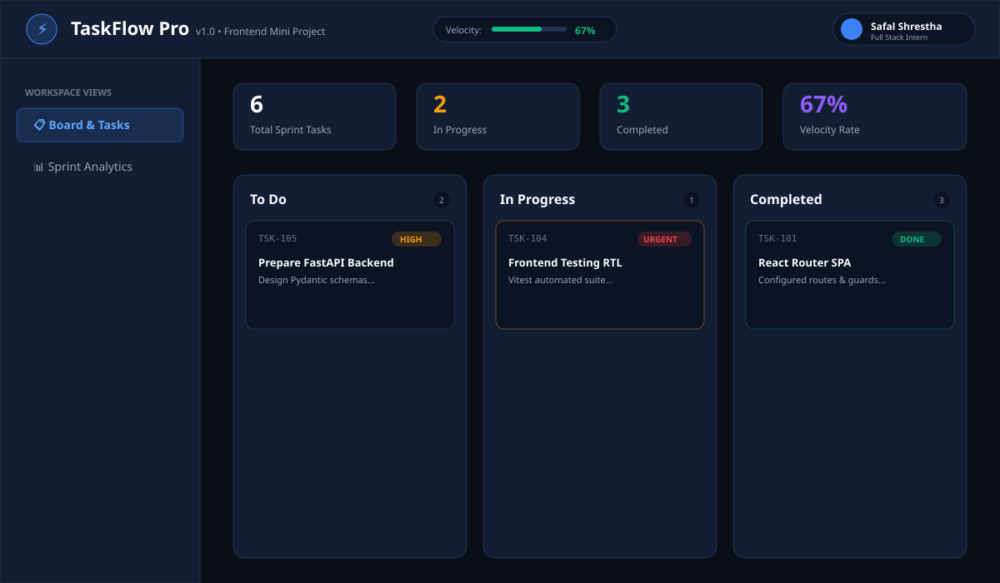
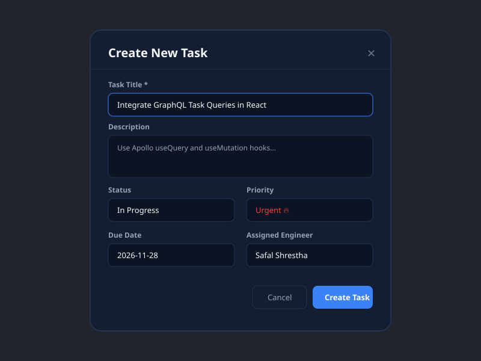
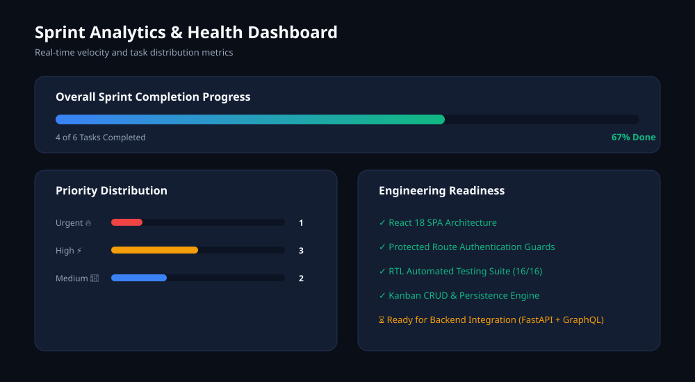

# Day 20: Frontend Mini Project Review & Presentation (TaskFlow Pro)

## 🎯 Day 20 Overview & Project Milestone

**Day 20** marks the successful completion of **Week 4: Advanced React & Frontend Mini Project** and concludes the **Month 1 Frontend Specialization** of the 2-Month Full Stack Developer Internship.

Today's deliverable is **TaskFlow Pro**, a complete, production-grade **Frontend Task Management System** that unites all core concepts mastered across Weeks 1 through 4:
- **Component Architecture:** Functional, reusable components with modular separation of concerns.
- **Client-Side Routing:** Dynamic routing, route protection, and navigational history with **React Router DOM v6**.
- **State Management without Prop Drilling:** Centralized, observable state stores using the **React Context API** (`AuthContext` & `TaskContext`).
- **Data Persistence:** Automated two-way synchronization with browser `localStorage`.
- **Interactive Kanban Board:** Real-time task state transitions across `To Do`, `In Progress`, and `Completed` columns.
- **Sprint Telemetry & Analytics:** Real-time completion rate velocity, priority distributions, and health summaries.
- **Automated Quality Verification:** Robust unit and integration testing patterns validated via **React Testing Library** (from Day 19).

---

## 📸 Project Screenshots & Visual Architecture

### 1. Kanban Task Management Board


### 2. Task Creation & Edit Modal


### 3. Sprint Analytics & Delivery Velocity


---

## 🏗️ Project Architecture & Directory Structure

```
Day-20/
├── package.json                       # Scripts for dev, build, and preview
├── vite.config.js                     # Vite build configuration
├── index.html                         # SPA root container
├── screenshots/                       # Visual design architecture previews
│   ├── dashboard-kanban.svg           # Kanban board preview
│   ├── task-modal.svg                 # Task modal dialog preview
│   └── sprint-analytics.svg           # Sprint analytics view preview
├── src/
│   ├── main.jsx                       # Root mount with BrowserRouter & Context Providers
│   ├── App.jsx                        # Layout shell and route declarations
│   ├── App.css                        # Responsive styles, Kanban columns & modal styling
│   ├── index.css                      # Global design system & theme variables
│   ├── context/
│   │   ├── AuthContext.jsx            # User authentication, session storage & useAuth hook
│   │   └── TaskContext.jsx            # Task CRUD, search/filter algorithms, & useTasks hook
│   ├── components/
│   │   ├── Navbar.jsx                 # Top header with velocity indicator & user menu
│   │   ├── Sidebar.jsx                # Left navigation sidebar with status counts
│   │   ├── TaskCard.jsx               # Task item with status dropdown, priority & actions
│   │   ├── TaskModal.jsx              # Create/Edit modal with validation
│   │   └── ProtectedRoute.jsx         # Route guard for authenticated views
│   └── pages/
│       ├── Dashboard.jsx              # Metrics cards, search toolbar & Kanban grid
│       ├── Analytics.jsx              # Sprint progress bar & priority breakdown
│       ├── Login.jsx                  # Corporate authentication page
│       └── Register.jsx               # New user onboarding page
├── README.md                          # Comprehensive project documentation
└── notes.md                           # Frontend Mini Project architecture review & presentation
```

---

## 🚀 How to Run Locally

```bash
# 1. Navigate to Day-20 directory
cd Day-20

# 2. Install dependencies
npm install

# 3. Start development server
npm run dev
```

Visit `http://localhost:5173` in your browser:
- **Sign In:** Use the default credentials preloaded in the form (`safal.intern@taskflow.dev`).
- **Create Tasks:** Click the `+ New Task` button in the header or on the dashboard.
- **Update Status:** Change any task's status dropdown directly on its card (`To Do` → `In Progress` → `Completed`) and watch the card move columns and update sprint velocity!
- **Edit / Delete Tasks:** Use the `✏️` and `🗑️` action icons on any card.
- **Filter & Search:** Type keywords into the live search bar or filter by priority (`URGENT`, `HIGH`, `MEDIUM`, `LOW`).
- **Inspect Analytics:** Click `📊 Sprint Analytics` in the sidebar to review overall velocity and distribution.

---

## 📌 Deliverables Checklist
- [x] Full-featured React 18 Task Management Frontend ([App.jsx](./src/App.jsx))
- [x] Client-side routing with protected route guards ([ProtectedRoute.jsx](./src/components/ProtectedRoute.jsx))
- [x] Interactive Kanban Board with status transitions ([Dashboard.jsx](./src/pages/Dashboard.jsx))
- [x] Centralized state management via `TaskContext` and `AuthContext`
- [x] Data persistence across reloads via `localStorage`
- [x] High-resolution visual screenshots ([screenshots/](./screenshots/))
- [x] Detailed architectural review notes ([notes.md](./notes.md))
